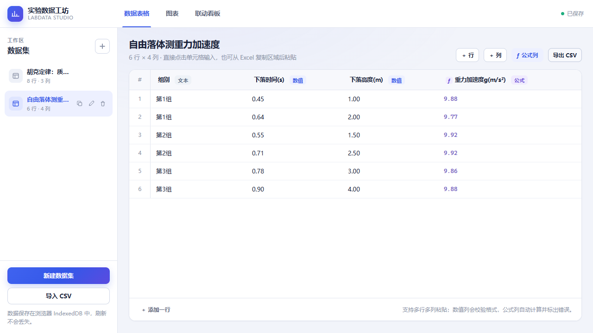
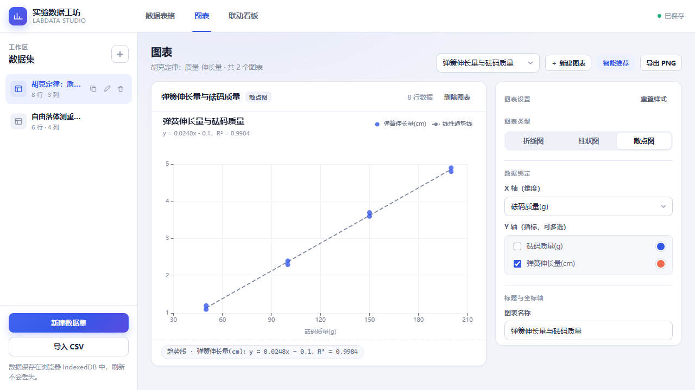
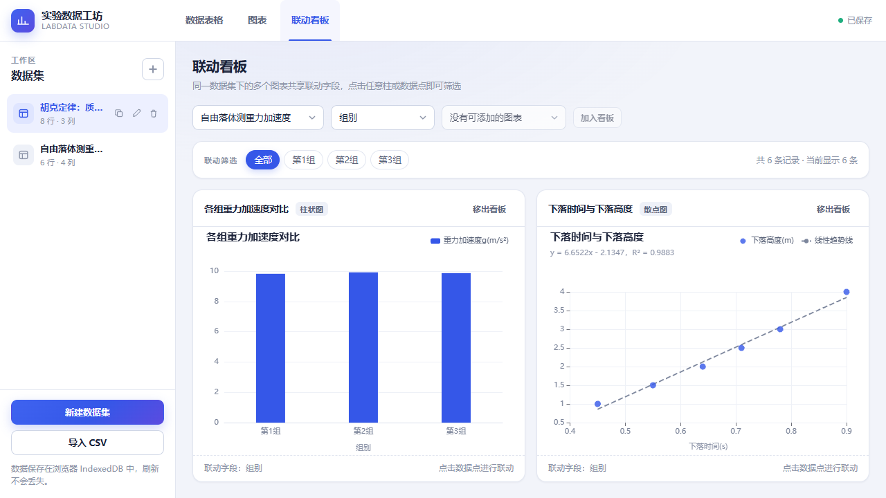

# 实验数据工坊 · LabData Studio

> 个人实验 / 作业数据记录与图表生成器 —— 纯前端、本地存储、打开即用。
>
> 参赛者：陈瑞祺、马郭栋　参赛形式：团队　赛题：赛题 4「个人实验 / 作业数据记录与图表生成器」

## 项目简介

做物理、化学、生物实验或课程作业时，数据往往零散地记在 Excel、纸质表格甚至聊天记录里，最后画图还要重新排版。"实验数据工坊"把**记录数据 → 校验 → 计算 → 出图 → 导出 → 看板联动**串成一条完整的工作流：

- 像表格软件一样直接录入，支持从 Excel 复制整块粘贴；
- 公式列自动计算派生量（如重力加速度、单位换算），趋势线自动给出方程与 R²；
- 一张图配置好样式后可直接导出高清 PNG，数据可导出 CSV 交给 Excel 处理；
- 多张图放进同一个看板，点击任意数据点即可按组别联动筛选；
- 内置规则式图表推荐，根据数据特征给出"画什么图、用哪两列"的建议。

**所有数据只保存在浏览器本地（IndexedDB），不上传任何服务器，断网也能用。**

## 功能说明

### 1. 结构化数据录入（基础功能）
- 数据集的新建 / 重命名 / 创建副本 / 删除，侧栏一键切换；
- 表格直接点击单元格编辑，支持增删行、增删列；
- 列类型支持**数值 / 文本 / 日期**，数值列校验非法输入，日期列要求 `YYYY-MM-DD`；
- **Excel 粘贴**：从 Excel 复制多行多列后，在单元格按 `Ctrl+V` 即可从当前位置批量填入，行列不足时自动扩展；
- **CSV 导入 / 导出**：RFC 4180 子集解析（支持引号、逗号、换行），导入时自动推断列类型、重名列自动去重；导出带 UTF-8 BOM，Excel 打开中文不乱码；
- 公式列只读展示、以 `ƒ` 标识，悬停可查看公式。

### 2. 图表生成与样式定制（基础功能）
- 图表类型：**折线图 / 柱状图 / 散点图**，折线图与柱状图支持多指标 Y 轴；
- 柱状图按 X 轴分类自动聚合（同一分类的多次测量取均值），避免重复类目产生并排柱；
- X 轴可选任意列，Y 轴从数值列 / 公式列中选择；
- 样式面板：图表标题、坐标轴名称、内置调色板与单系列颜色、图例开关、平滑曲线、面积填充、数值标签、堆叠、横向柱状；
- **PNG 导出**：2 倍分辨率、白底，中文正常渲染，文件名自动使用图表名。

### 3. 公式计算与趋势线（进阶功能）
- 手写表达式解析器（不使用 `eval` / `new Function`），语法：
  - 列引用：`[列名]`（支持中文列名）；
  - 运算符：`+ - * / ^`、括号、一元负号；
  - 函数：`abs` `sqrt` `round` `avg` `sum` `min` `max`（聚合函数作用于整列）；
  - 示例：`round(2*[下落高度(m)]/[下落时间(s)]^2, 2)`；
- 公式列可引用其他公式列（自动按依赖排序），循环引用会报错；
- 错误按单元格标注：`#SYNTAX` `#REF` `#VALUE` `#DIV0` `#CYCLE`，单个单元格出错不影响整表；
- 添加公式列时提供**前 3 行实时预览**，列名重复 / 引用不存在会在提交前拦截；
- 折线图、散点图可开启**线性趋势线**：最小二乘法回归，图例下方显示 `y = a + bx` 与 `R²`。

### 4. 多图联动看板（进阶功能）
- 看板约束为「同一数据集 + 同一联动字段（文本/日期列）」，避免维度不一致带来的歧义；
- 顶部按联动字段生成取值标签（chips），点击标签或直接点击图中柱/点，所有图表**同步过滤**；
- 再次点击同一值或"重置筛选"恢复全量；实时显示过滤后记录数；
- 看板内图表可随时加入 / 移出，配置随应用自动保存。

### 5. AI 风格图表推荐（进阶功能）
- 基于**本地规则引擎**分析数据集特征：列类型、数值列数量、行数、分类列基数、时间列与单调性；
- 规则示例：存在日期/时间列 → 折线图看趋势；分类数 2–12 → 柱状图做对比；两个以上数值列 → 散点图看相关；
- 每条建议给出**置信度、可读理由与推荐 X/Y 列**，支持一键应用为图表；
- 面板中明确标注"本地规则引擎，数据不出浏览器"，无外部 API 调用。

### 6. 本地持久化与示例数据
- IndexedDB 单文档存储整个工作区（数据集、图表、看板、当前 Tab），改动后约 300ms 防抖自动保存，顶栏实时显示"保存中 / 已保存 / 保存失败"；
- 刷新页面后数据、当前数据集与图表都会恢复；
- 首次启动内置两个示例数据集与 3 个示例图表，便于直接体验：
  - 「胡克定律：质量-伸长量」：砝码质量 / 弹簧伸长量 / 组别（散点 + 趋势线场景）；
  - 「自由落体测重力加速度」：下落时间 / 下落高度 / 公式列 `g`（柱状图与看板联动场景）。

## 使用方式

1. 左侧选择一个数据集（或点「新建数据集」「导入 CSV」）；
2. 在「数据表格」录入 / 粘贴数据，必要时点「ƒ 公式列」添加派生列；
3. 切到「图表」：新建图表并绑定 X/Y，右侧面板调整样式；「智能推荐」可一键生成建议配置；
4. 需要导出时点「导出 PNG」或「导出 CSV」；
5. 切到「联动看板」：选择联动字段，把图表加入看板，点击柱/点体验联动筛选。

> 提示：示例数据会随首次启动自动创建；如需从空白开始，删除示例数据集即可。

## 界面预览

| 数据表格与公式列 | 图表与趋势线 |
| --- | --- |
|  |  |

| 联动看板 | 智能推荐 |
| --- | --- |
|  |  |

## 技术栈

| 层 | 技术 | 版本 |
|---|---|---|
| 框架 | Vue 3（Composition API，`<script setup>`） | 3.5.46 |
| 构建 | Vite | 6.4.6 |
| 图表 | Apache ECharts（完整引入） | 5.6.0 |
| 本地存储 | IndexedDB，`idb` 封装（含 localStorage 降级） | idb 8.0.4 |
| 测试 | Vitest（公式 / 回归 / CSV / 图表配置 / 推荐 共 46 个用例） | 3.2.7 |
| 状态管理 | 自研单例响应式 store（`reactive` + `computed`），未使用 Pinia | — |
| UI | 手写组件 + 自定义 CSS 设计变量，无第三方 UI 库 | — |

项目不使用任何外部 CDN、在线字体或远程 API，界面与构建产物均可完全离线运行。

## 运行环境与启动步骤

**环境要求**：Node.js ≥ 18（开发时使用 Node 24 / npm 11）、现代浏览器（Chrome / Edge / Firefox 最新版）。

```bash
# 1. 安装依赖
npm install

# 2. 开发模式（默认 http://localhost:5173）
npm run dev

# 3. 单元测试
npm run test

# 4. 生产构建 + 本地预览（http://localhost:4173）
npm run build
npm run preview
```

**Windows 快速启动**：也可以直接双击项目根目录的 `start.bat`。脚本会检查 Node.js / npm，首次运行时自动安装依赖，并在启动开发服务器后打开浏览器；按提示关闭窗口即可停止服务。

**重要**：应用依赖 IndexedDB，请通过 `npm run dev` 或 `npm run preview` 启动后用 `http://localhost` 访问；不要直接双击 `dist/index.html`（`file://` 协议下浏览器会限制 IndexedDB）。

## 项目结构

```
lab-data-studio/
├─ index.html
├─ vite.config.js
├─ src/
│  ├─ main.js / App.vue            # 入口与整体布局（顶栏 + 侧栏 + Tab 视图）
│  ├─ styles/base.css              # 设计变量与通用组件样式
│  ├─ store/useStore.js            # 单例状态、业务动作与自动保存
│  ├─ storage/db.js                # IndexedDB 读写与降级
│  ├─ data/seed.js                 # 内置示例数据
│  ├─ lib/
│  │  ├─ formula.js                # 表达式词法/Pratt 解析/求值/依赖图
│  │  ├─ stats.js                  # 线性回归、R²、描述统计
│  │  ├─ csv.js                    # CSV/TSV 解析与序列化
│  │  ├─ chartOptions.js           # 图表配置 → ECharts option
│  │  ├─ recommend.js              # 规则式图表推荐
│  │  ├─ chartTypes.js / download.js / id.js
│  ├─ composables/useToast.js
│  └─ components/                  # 侧栏、表格、图表、看板、推荐、弹窗等
├─ tests/                          # Vitest 单元测试
├─ docs/
│  ├─ 开发文档.md                  # 架构、模块、数据模型与测试说明
│  ├─ 成员排名.md                  # 成员分工与 Git 贡献记录
│  └─ 演示脚本.md                  # 演示视频分镜脚本
└─ output/playwright/              # 端到端验证截图
```

## 项目文档

- [开发文档](docs/开发文档.md)：系统架构、数据模型、公式/统计/推荐算法、测试与部署说明；
- [成员排名与分工](docs/成员排名.md)：成员参与度排名、Git 提交证据与贡献边界；
- [演示脚本](docs/演示脚本.md)：3–5 分钟演示视频分镜与兜底方案。

## 测试与验证

- `npm run test`：5 个测试文件、46 个用例全部通过，覆盖公式优先级/函数/错误码、线性回归数值、CSV 往返解析、柱状图分类聚合与看板过滤、推荐规则排序；
- `npm run build`：生产构建成功，ECharts 与 Vue 单独分包；
- 已通过浏览器端到端走查：数据录入与公式计算、CSV 导入导出（Excel 中文正常）、三类图表与样式切换、趋势线与 R²、PNG 导出（中文清晰）、看板点击联动、推荐一键应用、刷新后持久化恢复。

## 第三方资源来源与许可证声明

本项目仅通过 npm 安装以下开源依赖，**未使用任何外部 CDN、图标库、在线字体或第三方数据接口**：

| 依赖 | 版本 | 许可证 | 来源 |
|---|---|---|---|
| Vue | 3.5.46 | MIT | https://github.com/vuejs/core |
| Apache ECharts | 5.6.0 | Apache-2.0 | https://github.com/apache/echarts |
| idb | 8.0.4 | ISC | https://github.com/jakearchibald/idb |
| Vite（开发依赖） | 6.4.6 | MIT | https://github.com/vitejs/vite |
| @vitejs/plugin-vue（开发依赖） | 5.2.4 | MIT | https://github.com/vitejs/vite-plugin-vue |
| Vitest（开发依赖） | 3.2.7 | MIT | https://github.com/vitest-dev/vitest |

图标均为手写内联 SVG，界面字体使用系统字体栈。

## AI 工具使用声明

本项目在开发过程中使用了 AI 编程助手（Claude Code）辅助完成脚手架搭建、部分组件实现与调试。需求定义、功能取舍、技术选型、数据模型设计、最终代码审查与验收均由参赛者本人完成；AI 生成的代码已逐项在浏览器中实际验证。图表推荐功能为本地确定性规则引擎，运行时不调用任何 AI 或外部 API。


